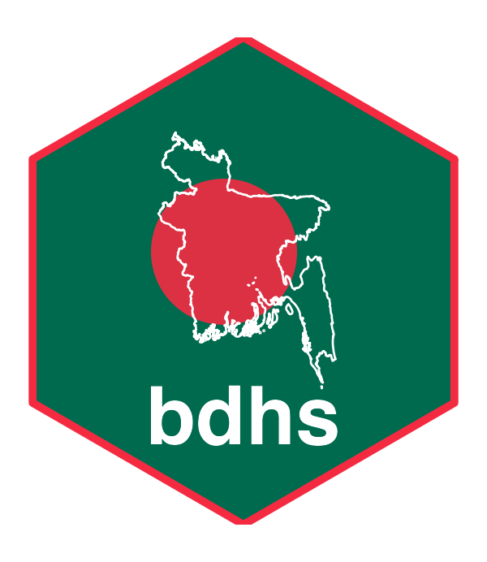

<!-- README.md is generated from README.Rmd. Please edit that file. -->

```{r, include = FALSE}
knitr::opts_chunk$set(
  collapse = TRUE,
  comment = "#>",
  fig.path = "man/figures/README-",
  out.width = "100%",
  dpi = 110
)
```

# bdhs 

<!-- badges: start -->
[](https://github.com/armanhossen-am/bdhs/actions/workflows/R-CMD-check.yaml)
[](https://lifecycle.r-lib.org/articles/stages.html#experimental)
[](https://github.com/armanhossen-am/bdhs/blob/main/LICENSE.md)
<!-- badges: end -->

**bdhs** is an R toolkit for every round of the **Bangladesh Demographic and
Health Survey**: 1993-94, 1996-97, 1999-2000, 2004, 2007, 2011, 2014, 2017-18
and 2022. It also covers the Bangladesh Service Provision Assessments and the
2001 maternal mortality survey.

It does two jobs:

1. **Ships the official numbers.** Every estimate the DHS Program publishes
   for Bangladesh (about 310,000 values: national, by division, by residence,
   wealth, education and more), with definitions, survey and dataset
   catalogues, cross-round codebooks, division crosswalks and maps. These work
   straight after installation, with no DHS account.
2. **Makes your own microdata painless.** Once you have downloaded BDHS files
   from the DHS Program, bdhs registers them, reads any round in one line,
   harmonizes variables across rounds, builds the correct complex survey
   design, pools rounds, and computes indicators that are validated against
   the official DHS estimates.

> **Why isn't the microdata included, like in `brfss`?** BRFSS is US public
> domain data. DHS microdata are licensed to registered users, and the DHS
> terms of use say they "will not be re-distributed, either directly or
> within any tool". bdhs respects that: it never bundles or uploads microdata.
> Registration is free and quick:
> <https://dhsprogram.com/data/new-user-registration.cfm>.

## Installation

```r
# install.packages("pak")
pak::pak("armanhossen-am/bdhs")
```

## Official estimates in one line

```{r}
library(bdhs)

bdhs_official("FE_FRTR_W_TFR")[, c("year_label", "indicator", "value")]
```

```{r trend, fig.width = 7, fig.height = 4.2}
bdhs_plot_trend("CN_NUTS_C_HA2", by = "Residence")
```

```{r map, fig.width = 5.5, fig.height = 6.3, out.width = "60%"}
bdhs_map("CN_NUTS_C_HA2", survey = 2022)
```

Not sure what an indicator or variable is called? Search everything at once:

```{r}
bdhs_search("caesarean")
```

## Your microdata in one line

```r
# Once: register the files you downloaded (folders, zips, renamed files are fine)
bdhs_import("~/Downloads/BDHS")
bdhs_inventory()                       # what you have vs. what exists

ir <- bdhs_read(2022, "IR")            # women, 2022
kr <- bdhs_read("2017-18", "KR",       # children, only the columns you need
                vars = c("m14", "m15", "m17", "hw70"))

bdhs_estimate(kr, c("anc_4plus", "facility_delivery", "csection", "stunting"),
              by = "v025")             # correct design, SEs, CIs

bdhs_validate(kr)                      # compare with official DHS values
```

Everything above also works on synthetic data, which is how the examples,
tests and vignettes run without real files:

```{r}
kr <- bdhs_simulate(2022, "KR")
des <- bdhs_design(kr)
des
```

## What's inside

| Bundled data | What it is |
|---|---|
| `bdhs_indicators` | Every official DHS estimate for Bangladesh, all rounds and breakdowns |
| `bdhs_indicator_catalog` | Definitions, denominators and coverage of each indicator |
| `bdhs_surveys`, `bdhs_datasets` | Survey facts and the full list of 441 DHS data files |
| `bdhs_codebook`, `bdhs_value_labels` | Variable names, labels and value labels across rounds (metadata only) |
| `bdhs_regions` | Division codes per round with a cross-round crosswalk |
| `bdhs_pool_population` | Female population 15-49 for pooled (de-normalized) weights |
| `bdhs_boundaries()` | Division boundaries for each survey (DHS Spatial Data Repository) |

| Task | Functions |
|---|---|
| Official estimates | `bdhs_official()`, `bdhs_plot_trend()`, `bdhs_map()` |
| Discover | `bdhs_search()`, `bdhs_variable()`, `bdhs_describe()` |
| Your files | `bdhs_import()`, `bdhs_read()`, `bdhs_inventory()`, `bdhs_download()` |
| Cross-round work | `bdhs_harmonize()`, `bdhs_pool()`, `bdhs_merge()`, `bdhs_na()` |
| Estimation | `bdhs_design()`, `bdhs_estimate()`, `bdhs_fertility()`, `bdhs_mortality()`, `bdhs_validate()` |
| Teaching and testing | `bdhs_simulate()` |

## Things bdhs handles for you

* **Ever-married samples.** Every BDHS women's sample is ever-married women,
  so "all women" indicators need the DHS all-woman factors (`awfactt` and
  friends). bdhs applies them where the DHS does.
* **Changing divisions.** Bangladesh went from 5 divisions (1993-94) to 8
  (2017-18 on), and the codes were renumbered when Mymensingh was created.
  bdhs maps every round onto consistent layouts.
* **Correct designs.** Clusters, sampling-error strata and weights per round,
  lonely PSUs, and pooled multi-round designs.
* **DHS quirks.** Special missing codes, flagged z-scores, 2-digit years in
  the early rounds, renamed and re-saved files, and recodes that only exist
  for some rounds.

## Citation and conditions of use

Please cite bdhs and the data sources (`citation("bdhs")`). When you publish
results from BDHS microdata, cite the survey's final report. The DHS Program's
conditions for Bangladesh also ask you to send a copy of the publication to
the NIPORT library.

bdhs is not affiliated with or endorsed by the DHS Program, ICF or NIPORT.
