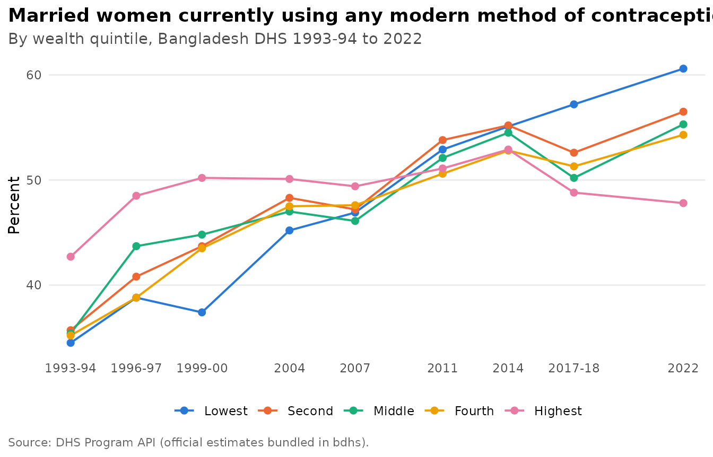

# Get started with bdhs

The Bangladesh Demographic and Health Survey (BDHS) has been run nine
times since 1993. bdhs gives you all of it in one place: the official
estimates right away, and your own copy of the microdata in one line
once you have DHS access.

``` r

library(bdhs)
```

## The surveys

``` r

bdhs_rounds()
#> # A tibble: 9 × 6
#>   survey_id survey_type  year year_label phase   file_code
#>   <chr>     <chr>       <int> <chr>      <chr>   <chr>    
#> 1 BD1994DHS DHS          1994 1993-94    DHS-III 31       
#> 2 BD1997DHS DHS          1997 1996-97    DHS-III 3A       
#> 3 BD2000DHS DHS          2000 1999-2000  DHS-IV  41       
#> 4 BD2004DHS DHS          2004 2004       DHS-IV  4J       
#> 5 BD2007DHS DHS          2007 2007       DHS-V   51       
#> 6 BD2011DHS DHS          2011 2011       DHS-VI  61       
#> 7 BD2014DHS DHS          2014 2014       DHS-7   72       
#> 8 BD2017DHS DHS          2017 2017-18    DHS-7   7R       
#> 9 BD2022DHS DHS          2022 2022       DHS-8   81
```

Functions take a `survey` argument, and you can refer to a round however
you like. Years, year ranges, DHS ids and DHS file codes all work:

``` r

bdhs_survey_id(c(2022, "2017-18", 2018, "BD2014DHS", "4J", "1999-2000"))
#> [1] "BD2022DHS" "BD2017DHS" "BD2017DHS" "BD2014DHS" "BD2004DHS" "BD2000DHS"
```

`bdhs_surveys` adds fieldwork dates, sample sizes and implementing
agencies, and `bdhs_datasets` lists every one of the 441 data files the
DHS Program distributes for Bangladesh:

``` r

bdhs_surveys[, c("survey_id", "survey_label", "fieldwork_start", "n_households", "n_women", "n_men")]
#> # A tibble: 13 × 6
#>    survey_id survey_label fieldwork_start n_households n_women n_men
#>    <chr>     <chr>        <date>                 <int>   <int> <int>
#>  1 BD1994DHS 1993-94      1993-11-01              9174    9640  3284
#>  2 BD1997DHS 1996-97      1996-11-01              8682    9127  3346
#>  3 BD1999SPA 1999-00      1999-09-01                NA      NA    NA
#>  4 BD2000DHS 1999-00      1999-11-01              9854   10544  2556
#>  5 BD2001OTH 2001         2001-01-01             99202  103796    NA
#>  6 BD2004DHS 2004         2004-01-01             10500   11440  4297
#>  7 BD2007DHS 2007         2007-03-01             10400   10996  3771
#>  8 BD2011DHS 2011         2011-07-01             17141   17842  3997
#>  9 BD2014DHS 2014         2014-06-01             17300   17863    NA
#> 10 BD2014SPA 2014         2014-06-01                NA      NA    NA
#> 11 BD2017DHS 2017-18      2017-10-01             19457   20127    NA
#> 12 BD2017SPA 2017         2017-08-01                NA      NA    NA
#> 13 BD2022DHS 2022         2022-08-01             30018   30078    NA
```

## Official estimates: no account needed

Every published DHS estimate for Bangladesh is bundled.
[`bdhs_official()`](https://armanhossen-am.github.io/bdhs/reference/bdhs_official.md)
returns tidy rows, and
[`bdhs_plot_trend()`](https://armanhossen-am.github.io/bdhs/reference/bdhs_plot_trend.md)
draws them:

``` r

bdhs_official("FP_CUSM_W_MOD")[, c("year_label", "indicator", "value")]
#> # A tibble: 9 × 3
#>   year_label indicator                                                     value
#>   <chr>      <chr>                                                         <dbl>
#> 1 1993-94    Married women currently using any modern method of contracep…  36.6
#> 2 1996-97    Married women currently using any modern method of contracep…  42.1
#> 3 1999-2000  Married women currently using any modern method of contracep…  44  
#> 4 2004       Married women currently using any modern method of contracep…  47.6
#> 5 2007       Married women currently using any modern method of contracep…  47.5
#> 6 2011       Married women currently using any modern method of contracep…  52.1
#> 7 2014       Married women currently using any modern method of contracep…  54.1
#> 8 2017-18    Married women currently using any modern method of contracep…  51.9
#> 9 2022       Married women currently using any modern method of contracep…  54.7
```

``` r

bdhs_plot_trend("FP_CUSM_W_MOD", by = "Wealth quintile")
```



See
[`vignette("maps-and-trends")`](https://armanhossen-am.github.io/bdhs/articles/maps-and-trends.md)
for subgroups, maps and more.

## Finding variables

[`bdhs_search()`](https://armanhossen-am.github.io/bdhs/reference/bdhs_search.md)
searches variable labels in the bundled codebooks, indicator definitions
and the harmonized variables together.
[`bdhs_variable()`](https://armanhossen-am.github.io/bdhs/reference/bdhs_variable.md)
shows one variable across rounds and flags when its labels changed:

``` r

bdhs_search("anemia|anaemia", where = "indicators")
#> # bdhs search for "anemia|anaemia": 10 matches
#> 
#> ── Official DHS indicators (10) ────────────────────────────────────────────────
#> CN_ANMC_C_ANY  Children with any anemia                     2011
#> CN_ANMC_C_MLD  Children with mild anemia                    2011
#> CN_ANMC_C_MOD  Children with moderate anemia                2011
#> CN_ANMC_C_SEV  Children with severe anemia                  2011
#> AN_ANEM_W_ANY  Women with any anemia                        2011
#> AN_ANEM_W_MLD  Women with mild anemia                       2011
#> AN_ANEM_W_MOD  Women with moderate anemia                   2011
#> AN_ANEM_W_SEV  Women with severe anemia                     2011
#> CN_ANMC_C_NUM  Number of children under age 5               2011
#> CN_ANMC_C_UNW  Number of children under age 5 (unweighted)  2011
bdhs_variable("v024", recode = "KR")
#> # A tibble: 8 × 6
#>   survey_id recode label    n_valid value_labels                     label_drift
#>   <chr>     <chr>  <chr>      <int> <chr>                            <lgl>      
#> 1 BD1994DHS KR     region      3874 1=barishal; 2=chittagong; 3=dha… TRUE       
#> 2 BD2000DHS KR     division    6832 1=barisal; 2=chittagong; 3=dhak… TRUE       
#> 3 BD2004DHS KR     region      6908 1=barisal; 2=chittagong; 3=dhak… TRUE       
#> 4 BD2007DHS KR     division    6150 1=barisal; 2=chittagong; 3=dhak… TRUE       
#> 5 BD2011DHS KR     region      8753 1=barisal; 2=chittagong; 3=dhak… TRUE       
#> 6 BD2014DHS KR     division    7886 1=barisal; 2=chittagong; 3=dhak… TRUE       
#> 7 BD2017DHS KR     division    8759 1=barisal; 2=chittagong; 3=dhak… TRUE       
#> 8 BD2022DHS KR     division    8784 1=barishal; 2=chattogram; 3=dha… FALSE
```

The codebooks contain names and labels only, never respondents’ values.

## Microdata: the two-minute version

1.  Register at <https://dhsprogram.com/data/new-user-registration.cfm>
    and request the Bangladesh surveys. It is free for research.
2.  Download the files you need. The Stata format is recommended.
3.  Point bdhs at them once:

``` r

bdhs_import("~/Downloads/BDHS")
```

From then on, any round and recode is one line away:

``` r

ir <- bdhs_read(2022, "IR")
kr <- bdhs_read(2017, "KR", vars = c("m14", "m15", "m17"))
```

[`vignette("microdata")`](https://armanhossen-am.github.io/bdhs/articles/microdata.md)
explains importing, storage and the experimental downloader.

## Practise with synthetic data

[`bdhs_simulate()`](https://armanhossen-am.github.io/bdhs/reference/bdhs_simulate.md)
generates fake data with the exact structure of a BDHS recode: the same
variable names, codes, labels and survey design. All the examples in
bdhs use it, and you can use it to write and test your code before your
DHS access comes through:

``` r

kr <- bdhs_simulate(2022, "KR")
kr[1:5, c("caseid", "v001", "v022", "v024", "m15", "m17")]
#> # A tibble: 5 × 6
#>   caseid             v001 v022               v024         m15             m17   
#>   <chr>             <dbl> <dbl+lbl>          <dbl+lbl>    <dbl+lbl>       <dbl+>
#> 1 "       1   2  2"     1 1 [barishal urban] 1 [barishal] 11 [respondent… 0 [no]
#> 2 "       1   2  2"     1 1 [barishal urban] 1 [barishal] 11 [respondent… 0 [no]
#> 3 "       1   3  2"     1 1 [barishal urban] 1 [barishal] 12 [other home] 0 [no]
#> 4 "       1   3  2"     1 1 [barishal urban] 1 [barishal] 31 [private ho… 0 [no]
#> 5 "       1   9  2"     1 1 [barishal urban] 1 [barishal] 11 [respondent… 0 [no]
```

Simulated values are random and must never be used for conclusions.

## A first analysis

Survey data need survey methods.
[`bdhs_design()`](https://armanhossen-am.github.io/bdhs/reference/bdhs_design.md)
knows the clustering, stratification and weights of every round:

``` r

des <- bdhs_design(kr)
survey::svymean(~m17, des, na.rm = TRUE)
#>        mean     SE
#> m17 0.30917 0.0286
```

[`bdhs_estimate()`](https://armanhossen-am.github.io/bdhs/reference/bdhs_estimate.md)
goes a step further. It computes named DHS indicators with correct
standard errors, confidence intervals and denominators:

``` r

bdhs_estimate(kr, c("rh_del_facility", "rh_del_csection"), by = "v025")
#> # BDHS estimates: 2 indicators | BD2022DHS | 95% CI
#> # A tibble: 4 × 11
#>   survey_id indicator     label v025  estimate    se ci_low ci_high n_unweighted
#>   <chr>     <chr>         <chr> <fct>    <dbl> <dbl>  <dbl>   <dbl>        <int>
#> 1 BD2022DHS rh_del_facil… Deli… urban     59.4  7.93   42.6    74.2           78
#> 2 BD2022DHS rh_del_facil… Deli… rural     49.7  2.96   43.7    55.8           84
#> 3 BD2022DHS rh_del_csect… Deli… urban     29.2  6.66   17.5    44.5           78
#> 4 BD2022DHS rh_del_csect… Deli… rural     31.4  4.08   23.6    40.4           84
#> # ℹ 2 more variables: n_weighted <dbl>, api_id <chr>
```

## Where next

- [`vignette("microdata")`](https://armanhossen-am.github.io/bdhs/articles/microdata.md):
  importing, reading and storing your files.
- [`vignette("survey-design")`](https://armanhossen-am.github.io/bdhs/articles/survey-design.md):
  weights, strata, ever-married samples and pooling rounds.
- [`vignette("harmonization")`](https://armanhossen-am.github.io/bdhs/articles/harmonization.md):
  comparable variables across 30 years.
- [`vignette("indicators")`](https://armanhossen-am.github.io/bdhs/articles/indicators.md):
  the indicator library, fertility and mortality rates, and validation
  against official values.
- [`vignette("maps-and-trends")`](https://armanhossen-am.github.io/bdhs/articles/maps-and-trends.md):
  official estimates, trends and maps.
