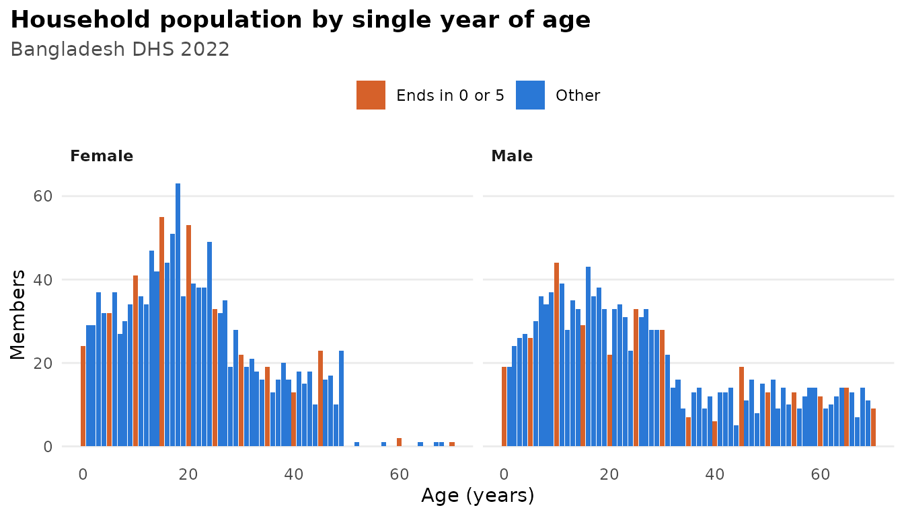
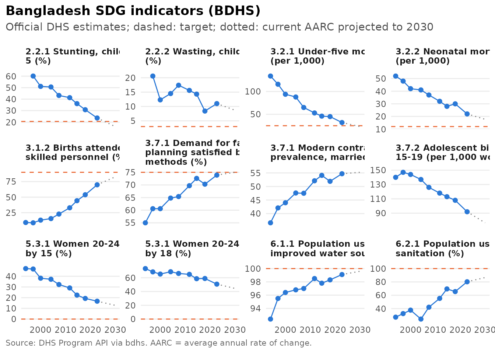

# Synthetic data, data quality and inequality

``` r

library(bdhs)
```

This article covers tools that go beyond computing a single estimate:

- calibrated synthetic data that reproduce the official numbers;
- checks of data quality;
- tests of change over time;
- measures of inequality;
- decomposition of change;
- progress towards the Sustainable Development Goals.

Everything below runs on synthetic data or on the bundled official
estimates. With your own files from
[`bdhs_read()`](https://armanhossen-am.github.io/bdhs/reference/bdhs_read.md),
the same code gives real results.

## Synthetic data that match the official estimates

[`bdhs_simulate()`](https://armanhossen-am.github.io/bdhs/reference/bdhs_simulate.md)
produces files with the right structure but random values.
[`bdhs_synthesize()`](https://armanhossen-am.github.io/bdhs/reference/bdhs_synthesize.md)
goes further. It calibrates the synthetic data so that key indicators
reproduce the official DHS estimates, nationally and by division and
residence. It uses only the published aggregates bundled with the
package, so the result contains no information about any real respondent
and can be shared freely.

``` r

kr <- bdhs_synthesize(2022, "KR", scale = 0.3)
attr(kr, "bdhs_targets")
#> # A tibble: 44 × 7
#>    survey_id indicator       api_id      margin category official_label official
#>    <chr>     <chr>           <chr>       <chr>  <chr>    <chr>             <dbl>
#>  1 BD2022DHS rh_del_facility RH_DELP_C_… natio… Total    Total              63.5
#>  2 BD2022DHS rh_del_facility RH_DELP_C_… divis… barishal Barishal           52.3
#>  3 BD2022DHS rh_del_facility RH_DELP_C_… divis… chattog… Chattogram         58.3
#>  4 BD2022DHS rh_del_facility RH_DELP_C_… divis… dhaka    Dhaka              69.9
#>  5 BD2022DHS rh_del_facility RH_DELP_C_… divis… khulna   Khulna             81.9
#>  6 BD2022DHS rh_del_facility RH_DELP_C_… divis… mymensi… Mymensingh         51.6
#>  7 BD2022DHS rh_del_facility RH_DELP_C_… divis… rajshahi Rajshahi           69.9
#>  8 BD2022DHS rh_del_facility RH_DELP_C_… divis… rangpur  Rangpur            60.5
#>  9 BD2022DHS rh_del_facility RH_DELP_C_… divis… sylhet   Sylhet             50.6
#> 10 BD2022DHS rh_del_facility RH_DELP_C_… resid… urban    Urban              73.9
#> # ℹ 34 more rows
```

[`bdhs_synthetic_fidelity()`](https://armanhossen-am.github.io/bdhs/reference/bdhs_synthetic_fidelity.md)
compares each calibrated value with the official one:

``` r

fid <- bdhs_synthetic_fidelity(kr)
fid[fid$margin == "national", c("indicator", "official", "synthetic", "diff")]
#> # A tibble: 4 × 4
#>   indicator       official synthetic    diff
#>   <chr>              <dbl>     <dbl>   <dbl>
#> 1 rh_del_facility     63.5     63.5  0.0166 
#> 2 rh_del_csection     44       44.0  0.00575
#> 3 rh_anc_4plus        39.6     39.6  0.0210 
#> 4 ch_diarrhoea         4.8      4.82 0.0231
summary(abs(fid$diff))
#>     Min.  1st Qu.   Median     Mean  3rd Qu.     Max. 
#> 0.003076 0.007218 0.010419 0.011131 0.013858 0.028030
```

Analyses on synthetic data therefore produce realistic numbers:

``` r

bdhs_estimate(kr, c("rh_del_facility", "rh_del_csection"), by = "v025")
#> # BDHS estimates: 2 indicators | BD2022DHS | 95% CI
#> # A tibble: 4 × 11
#>   survey_id indicator     label v025  estimate    se ci_low ci_high n_unweighted
#>   <chr>     <chr>         <chr> <fct>    <dbl> <dbl>  <dbl>   <dbl>        <int>
#> 1 BD2022DHS rh_del_facil… Deli… urban     73.9  1.56   70.7    76.9          870
#> 2 BD2022DHS rh_del_facil… Deli… rural     59.7  1.49   56.7    62.6         1701
#> 3 BD2022DHS rh_del_csect… Deli… urban     53.9  2.01   49.9    57.8          870
#> 4 BD2022DHS rh_del_csect… Deli… rural     40.4  1.47   37.5    43.3         1701
#> # ℹ 2 more variables: n_weighted <dbl>, api_id <chr>
```

Synthetic data are meant for teaching, testing code and sharing
reproducible examples. Only the calibrated indicators and margins match
the real survey. Associations between variables, and every variable that
was not calibrated, are artificial. Never draw substantive conclusions
from synthetic data.

## Data quality

[`bdhs_quality()`](https://armanhossen-am.github.io/bdhs/reference/bdhs_quality.md)
runs the standard DHS data-quality checks on whatever file you give it:

- age heaping (Whipple and Myers indices);
- women shifted out of the eligible age range (ratios at ages 15 and
  50);
- completeness of birth dates;
- births displaced out of the five-year window;
- heaping of age at death at 12 months;
- anthropometric quality (z-score SDs, flagged values, digit
  preference).

``` r

pr <- bdhs_simulate(2022, "PR")
q <- bdhs_quality(pr)
#> ℹ Skipped checks the data do not support:
#> • "birth_date_completeness": needs b10 (completeness of birth date; BR, KR or
#>   IR)
#> • "births_by_year": needs b3 and v008 (dates of birth and interview; BR, KR or
#>   IR)
#> • "age_at_death": needs b6 (age at death; BR, KR or IR)
q[q$check == "age_heaping", c("statistic", "group", "value", "interpretation")]
#> # A tibble: 7 × 4
#>   statistic       group   value interpretation 
#>   <chr>           <chr>   <dbl> <chr>          
#> 1 whipple         total  101.   highly accurate
#> 2 myers           total    3.70 NA             
#> 3 whipple         male   105.   highly accurate
#> 4 myers           male     4.06 NA             
#> 5 whipple         female  96.4  highly accurate
#> 6 myers           female   4.01 NA             
#> 7 pct_age_missing total    0    NA
```

``` r

plot(q, type = "age")
```



On real data these checks are informative. In the BDHS, for example,
men’s ages are heavily heaped on numbers ending in 0 and 5, and far
fewer women are recorded at age 50 than at 49.

## Is a change significant?

[`bdhs_compare()`](https://armanhossen-am.github.io/bdhs/reference/bdhs_compare.md)
tests differences between rounds, which are independent samples, or
between groups within a round, using the full design-based covariance:

``` r

k14 <- bdhs_synthesize(2014, "KR", scale = 0.3, seed = 1)
k22 <- bdhs_synthesize(2022, "KR", scale = 0.3, seed = 2)
cmp <- bdhs_compare(k14, k22, indicators = "rh_del_csection")
cmp[, c("survey_1", "survey_2", "estimate_1", "estimate_2", "difference", "p_value", "annual_change")]
#> # A tibble: 1 × 7
#>   survey_1  survey_2  estimate_1 estimate_2 difference  p_value annual_change
#>   <chr>     <chr>          <dbl>      <dbl>      <dbl>    <dbl>         <dbl>
#> 1 BD2014DHS BD2022DHS       23.1       44.0       20.9 1.23e-30          2.58
```

It warns you when division-level comparisons cross rounds with different
division layouts. Use the harmonized `division_trend6` for those.

## Inequality

[`bdhs_inequality()`](https://armanhossen-am.github.io/bdhs/reference/bdhs_inequality.md)
measures wealth-related inequality with design-based standard errors:

- the rich-poor difference and ratio;
- the slope and relative indices of inequality (SII, RII);
- the concentration index, and Erreygers’ corrected version for binary
  outcomes.

``` r

bdhs_inequality(k22, "rh_del_csection", by = "v190")
#> # BDHS inequality: rh_del_csection by v190 | BD2022DHS
#> # A tibble: 6 × 13
#>   survey_id indicator   label by    measure measure_label estimate     se ci_low
#>   <chr>     <chr>       <chr> <chr> <chr>   <chr>            <dbl>  <dbl>  <dbl>
#> 1 BD2022DHS rh_del_cse… Deli… v190  differ… Difference (…   52.3   3.39   45.6  
#> 2 BD2022DHS rh_del_cse… Deli… v190  ratio   Ratio (highe…    3.97  0.480   3.13 
#> 3 BD2022DHS rh_del_cse… Deli… v190  sii     Slope index …   64.5   3.67   57.2  
#> 4 BD2022DHS rh_del_cse… Deli… v190  rii     Relative ind…    4.57  0.424   3.80 
#> 5 BD2022DHS rh_del_cse… Deli… v190  ci      Concentratio…    0.234 0.0138  0.207
#> 6 BD2022DHS rh_del_cse… Deli… v190  eci     Erreygers co…    0.412 0.0240  0.365
#> # ℹ 4 more variables: ci_high <dbl>, lowest <chr>, highest <chr>,
#> #   n_groups <int>
```

The same measures can be computed from the official estimates by wealth
quintile, without any microdata:

``` r

bdhs_inequality_official("rh_del_csection", survey = c(2004, 2022))
#> # BDHS inequality: RH_DELA_C_CSC by Wealth quintile | BD2004DHS, BD2022DHS
#> # A tibble: 12 × 13
#>    survey_id indicator   label by    measure measure_label estimate    se ci_low
#>    <chr>     <chr>       <chr> <chr> <chr>   <chr>            <dbl> <dbl>  <dbl>
#>  1 BD2004DHS RH_DELA_C_… Deli… Weal… differ… Difference (…   18.3      NA     NA
#>  2 BD2004DHS RH_DELA_C_… Deli… Weal… ratio   Ratio (highe…  184        NA     NA
#>  3 BD2004DHS RH_DELA_C_… Deli… Weal… sii     Slope index …   18.4      NA     NA
#>  4 BD2004DHS RH_DELA_C_… Deli… Weal… rii     Relative ind…  529.       NA     NA
#>  5 BD2004DHS RH_DELA_C_… Deli… Weal… ci      Concentratio…    0.656    NA     NA
#>  6 BD2004DHS RH_DELA_C_… Deli… Weal… eci     Erreygers co…    0.118    NA     NA
#>  7 BD2022DHS RH_DELA_C_… Deli… Weal… differ… Difference (…   45.6      NA     NA
#>  8 BD2022DHS RH_DELA_C_… Deli… Weal… ratio   Ratio (highe…    3.05     NA     NA
#>  9 BD2022DHS RH_DELA_C_… Deli… Weal… sii     Slope index …   53.0      NA     NA
#> 10 BD2022DHS RH_DELA_C_… Deli… Weal… rii     Relative ind…    3.43     NA     NA
#> 11 BD2022DHS RH_DELA_C_… Deli… Weal… ci      Concentratio…    0.193    NA     NA
#> 12 BD2022DHS RH_DELA_C_… Deli… Weal… eci     Erreygers co…    0.339    NA     NA
#> # ℹ 4 more variables: ci_high <dbl>, lowest <chr>, highest <chr>,
#> #   n_groups <int>
```

## Why did it change? Decomposition

[`bdhs_decompose()`](https://armanhossen-am.github.io/bdhs/reference/bdhs_decompose.md)
splits the change between two rounds into two parts: a **composition**
part, due to a different mix of people (for example, more educated
mothers), and a **within-group** part, due to change within each group.
It uses Kitagawa’s method, with jackknife standard errors.

``` r

h14 <- bdhs_harmonize(k14, vars = "mother_edu_level")
h22 <- bdhs_harmonize(k22, vars = "mother_edu_level")
dec <- bdhs_decompose(h14, h22, "rh_del_csection", by = "mother_edu_level", se = "none")
dec[dec$group == "All", c("component", "estimate", "percent")]
#> # Kitagawa decomposition: rh_del_csection by mother_edu_level, BD2014DHS -> BD2022DHS
#> # A tibble: 3 × 3
#>   component   estimate percent
#>   <chr>          <dbl>   <dbl>
#> 1 composition   -0.331   -1.58
#> 2 within        21.3    102.  
#> 3 total         20.9    100
```

## Progress towards the SDGs

[`bdhs_sdg()`](https://armanhossen-am.github.io/bdhs/reference/bdhs_sdg.md)
tracks Bangladesh’s progress towards SDG-related targets from the
official estimates. It reports the annual rate of change, the rate
needed to reach the 2030 target, and whether progress is on track.

``` r

s <- bdhs_sdg()
s[, c("sdg", "name", "latest_value", "target", "aarc", "required_aarc", "on_track")]
#> # BDHS SDG tracker (official DHS estimates) | target year 2030 | AARC in % per year
#> # A tibble: 12 × 7
#>    sdg   name                  latest_value target   aarc required_aarc on_track
#>    <chr> <chr>                        <dbl>  <dbl>  <dbl>         <dbl> <lgl>   
#>  1 2.2.1 Stunting, children u…         23.6   20.6  5.10          1.86  TRUE    
#>  2 2.2.2 Wasting, children un…         11      3    3.18         16.4   FALSE   
#>  3 3.2.1 Under-five mortality…         32     25    4.37          3.35  TRUE    
#>  4 3.2.2 Neonatal mortality r…         22     12    2.92          8.02  FALSE   
#>  5 3.1.2 Births attended by s…         69.9   90    7.29         14.1   FALSE   
#>  6 3.7.1 Demand for family pl…         73.9   75    0.596         0.592 TRUE    
#>  7 3.7.1 Modern contraceptive…         54.7   NA    0.162        NA     NA      
#>  8 3.7.2 Adolescent birth rat…         92     NA    2.50         NA     NA      
#>  9 5.3.1 Women 20-24 first ma…         16.7    0    3.55         NA     FALSE   
#> 10 5.3.1 Women 20-24 first ma…         50.7    0    1.77         NA     FALSE   
#> 11 6.1.1 Population using an …         99.1  100   10.4          NA     TRUE    
#> 12 6.2.1 Population using imp…         80.2  100    5.18         NA     FALSE
```

``` r

plot(s)
```


