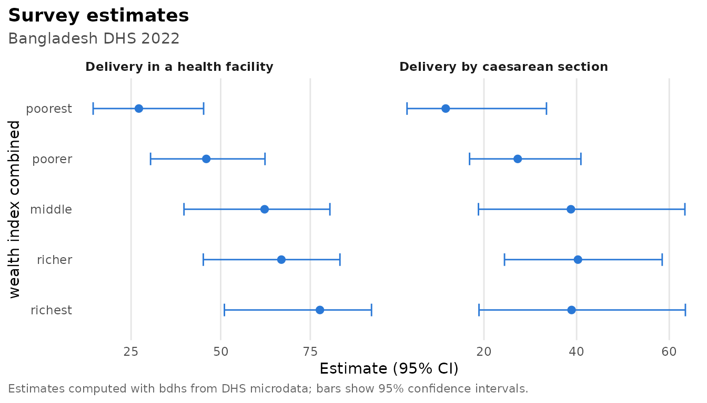

# Indicators, rates and validation

``` r

library(bdhs)
```

DHS indicators look simple (“percentage of births delivered in a health
facility”) but each one hides decisions. Which births count, from which
time window, with which weight, and how should ever-married samples or
missing codes be handled? bdhs encodes these decisions once, following
the DHS Program’s definitions. Each indicator was then checked against
the official estimates using real BDHS files.

The examples below use synthetic data from
[`bdhs_simulate()`](https://armanhossen-am.github.io/bdhs/reference/bdhs_simulate.md),
so the numbers are random. With your own data from
[`bdhs_read()`](https://armanhossen-am.github.io/bdhs/reference/bdhs_read.md)
they reproduce the BDHS reports.

## The indicator library

``` r

ind <- bdhs_indicator_list()
nrow(ind)
#> [1] 97
table(ind$topic)
#> 
#>      biomarkers    child_health education_media     empowerment family_planning 
#>               2              16               7               6              18 
#>       fertility       household        marriage maternal_health       mortality 
#>               7               7               4              10               5 
#>       nutrition 
#>              15
ind[ind$topic == "maternal_health", c("id", "label", "recode", "api_id")]
#> # A tibble: 10 × 4
#>    id                     label                                    recode api_id
#>    <chr>                  <chr>                                    <chr>  <chr> 
#>  1 rh_anc_skilled         Antenatal care from a skilled provider   KR     RH_AN…
#>  2 rh_anc_doctor          Antenatal care from a doctor             KR     RH_AN…
#>  3 rh_anc_4plus           Four or more antenatal care visits       KR     RH_AN…
#>  4 rh_anc_first_trimester First antenatal visit before the fourth… KR     RH_AN…
#>  5 rh_del_facility        Delivery in a health facility            KR     RH_DE…
#>  6 rh_del_home            Delivery at home                         KR     RH_DE…
#>  7 rh_del_skilled         Delivery assisted by a skilled provider  KR     RH_DE…
#>  8 rh_del_doctor          Delivery assisted by a doctor            KR     RH_DE…
#>  9 rh_del_csection        Delivery by caesarean section            KR     RH_DE…
#> 10 rh_pnc_mother_2days    Postnatal check of the mother within tw… KR     RH_PC…
```

Every indicator has an `id`, the recode it is computed from, and the DHS
Program API id of the matching official estimate (`api_id`), which is
also in the bundled `bdhs_indicators`. The `definition` and `notes`
columns say exactly what is computed:

``` r

x <- ind[ind$id == "rh_del_skilled", ]
writeLines(strwrap(c(x$definition, "", x$notes), width = 76))
#> Percentage of live births in the 3 years before the survey assisted by a
#> medically trained provider (SDG 3.1.2).
#> 
#> Bangladesh definition of medically trained provider; the m3* letters differ
#> by round (doctor and nurse/midwife only up to 2004).
```

## Estimating

[`bdhs_estimate()`](https://armanhossen-am.github.io/bdhs/reference/bdhs_estimate.md)
takes a recode data frame and indicator ids. It builds the survey design
([`bdhs_design()`](https://armanhossen-am.github.io/bdhs/reference/bdhs_design.md))
and returns estimates with standard errors, confidence intervals and
denominators:

``` r

kr <- bdhs_simulate(2022, "KR")
bdhs_estimate(kr, c("rh_anc_4plus", "rh_del_facility", "rh_del_csection"))
#> # BDHS estimates: 3 indicators | BD2022DHS | 95% CI
#> # A tibble: 3 × 10
#>   survey_id indicator       label     estimate    se ci_low ci_high n_unweighted
#>   <chr>     <chr>           <chr>        <dbl> <dbl>  <dbl>   <dbl>        <int>
#> 1 BD2022DHS rh_anc_4plus    Four or …     32.7  2.88   27.1    38.9          145
#> 2 BD2022DHS rh_del_facility Delivery…     54.1  4.07   45.6    62.3          162
#> 3 BD2022DHS rh_del_csection Delivery…     30.4  3.73   23.3    38.6          162
#> # ℹ 2 more variables: n_weighted <dbl>, api_id <chr>
```

Add `by` for subgroups. Labelled variables are shown with their labels:

``` r

est <- bdhs_estimate(kr, c("rh_del_facility", "rh_del_csection"), by = "v190")
est
#> # BDHS estimates: 2 indicators | BD2022DHS | 95% CI
#> # A tibble: 10 × 11
#>    survey_id indicator    label v190  estimate    se ci_low ci_high n_unweighted
#>    <chr>     <chr>        <chr> <fct>    <dbl> <dbl>  <dbl>   <dbl>        <int>
#>  1 BD2022DHS rh_del_faci… Deli… poor…     27.2  7.62  14.4     45.2           36
#>  2 BD2022DHS rh_del_faci… Deli… poor…     46.0  8.01  30.4     62.4           40
#>  3 BD2022DHS rh_del_faci… Deli… midd…     62.3 10.4   39.8     80.5           22
#>  4 BD2022DHS rh_del_faci… Deli… rich…     66.9  9.65  45.2     83.3           38
#>  5 BD2022DHS rh_del_faci… Deli… rich…     77.7 10.1   51.0     92.1           26
#>  6 BD2022DHS rh_del_csec… Deli… poor…     11.7  6.68   3.40    33.5           36
#>  7 BD2022DHS rh_del_csec… Deli… poor…     27.3  5.89  16.9     40.9           40
#>  8 BD2022DHS rh_del_csec… Deli… midd…     38.8 11.6   18.8     63.4           22
#>  9 BD2022DHS rh_del_csec… Deli… rich…     40.3  8.57  24.4     58.5           38
#> 10 BD2022DHS rh_del_csec… Deli… rich…     38.9 11.6   18.9     63.5           26
#> # ℹ 2 more variables: n_weighted <dbl>, api_id <chr>
```

``` r

plot(est)
```



A few details are handled for you:

- **Percentages** are on the 0-100 scale, as in DHS reports (`scale`).
  Confidence intervals are computed on the logit scale, so they stay
  between 0 and 100 (`ci_method = "wald"` gives symmetric intervals).
- **All-women indicators.** BDHS interviews only ever-married women, so
  indicators about all women, such as child marriage or teenage
  childbearing, use the DHS all-woman factors through a ratio estimator.
  The factor that matches a single `by` variable is used (`awfactu` for
  residence, `awfactr` for division, and so on).
- **Medians** (age at first marriage) use the DHS interpolation and
  jackknife standard errors.
- **Round differences.** Some definitions change between rounds, for
  example who counts as a skilled provider, the 2022 short
  questionnaire, or solar electricity in 2022. These are built into each
  indicator. An indicator that a round did not collect is skipped with a
  warning.

``` r

ir <- bdhs_simulate(2022, "IR")
bdhs_estimate(ir, c("fp_cpr_modern", "fp_unmet_total", "ms_married_by_18", "ms_median_afm_20_49"))
#> # BDHS estimates: 4 indicators | BD2022DHS | 95% CI
#> # A tibble: 4 × 10
#>   survey_id indicator           label estimate    se ci_low ci_high n_unweighted
#>   <chr>     <chr>               <chr>    <dbl> <dbl>  <dbl>   <dbl>        <int>
#> 1 BD2022DHS fp_cpr_modern       Cont…    55.0  2.12   50.6    59.3           515
#> 2 BD2022DHS fp_unmet_total      Unme…     5.06 1.01    3.34    7.60          515
#> 3 BD2022DHS ms_married_by_18    Wome…    46.5  3.72   39.0    54.2            85
#> 4 BD2022DHS ms_median_afm_20_49 Medi…    17.2  0.154  16.9    17.5           477
#> # ℹ 2 more variables: n_weighted <dbl>, api_id <chr>
```

### Pooled rounds

Pooled data (see
[`vignette("survey-design")`](https://armanhossen-am.github.io/bdhs/articles/survey-design.md))
are estimated round by round:

``` r

pooled <- bdhs_pool(bdhs_simulate(2014, "KR", seed = 1), bdhs_simulate(2022, "KR", seed = 2))
#> ℹ Value labels differ between rounds for 3 columns; kept the codes and dropped
#>   the labels: `v022`, `v023`, and `v024`.
#> ℹ DHS codes are not always comparable across rounds; use `harmonize = TRUE` or
#>   `bdhs_harmonize()` for comparable variables.
bdhs_estimate(pooled, "rh_del_csection")
#> # BDHS estimates: 1 indicator | BD2014DHS, BD2022DHS | 95% CI
#> # A tibble: 2 × 10
#>   survey_id indicator       label     estimate    se ci_low ci_high n_unweighted
#>   <chr>     <chr>           <chr>        <dbl> <dbl>  <dbl>   <dbl>        <int>
#> 1 BD2014DHS rh_del_csection Delivery…     33.7  3.82   26.4    42.0          161
#> 2 BD2022DHS rh_del_csection Delivery…     29.2  3.88   21.8    37.8          166
#> # ℹ 2 more variables: n_weighted <dbl>, api_id <chr>
```

## Indicators as variables for modelling

[`bdhs_add_indicators()`](https://armanhossen-am.github.io/bdhs/reference/bdhs_add_indicators.md)
adds indicator columns to your data. They are 0/1 inside the denominator
and `NA` outside it, so they are ready for regression:

``` r

kr2 <- bdhs_add_indicators(kr, "rh_del_csection")
des <- bdhs_design(kr2)
fit <- survey::svyglm(rh_del_csection ~ factor(v025) + factor(v106), design = des, family = quasibinomial())
round(coef(summary(fit)), 3)
#>               Estimate Std. Error t value Pr(>|t|)
#> (Intercept)     -1.479      0.487  -3.038    0.006
#> factor(v025)2    0.140      0.383   0.367    0.718
#> factor(v106)1    0.408      0.523   0.781    0.444
#> factor(v106)2    1.034      0.620   1.668    0.111
#> factor(v106)3    0.594      0.583   1.020    0.320
```

## Fertility and mortality rates

Rates need the DHS synthetic-cohort methods. These are implemented
natively, with jackknife standard errors, and checked against the
DHS.rates package and the official values.

``` r

bdhs_fertility(ir)                         # TFR, last 3 years
#> # A tibble: 1 × 12
#>   survey_id indicator age_group estimate    se ci_low ci_high n_births exposure
#>   <chr>     <chr>     <chr>        <dbl> <dbl>  <dbl>   <dbl>    <dbl>    <dbl>
#> 1 BD2022DHS tfr       15-49         2.80 0.172   2.47    3.14      169    1931.
#> # ℹ 3 more variables: n_women <int>, n_psu <int>, period <int>
bdhs_fertility(ir, type = "asfr")[, c("age_group", "estimate", "se")]
#> # A tibble: 7 × 3
#>   age_group estimate    se
#>   <chr>        <dbl> <dbl>
#> 1 15-19        96.4  12.9 
#> 2 20-24       214.   16.6 
#> 3 25-29       128.   17.7 
#> 4 30-34        74.0  16.1 
#> 5 35-39        23.9  11.6 
#> 6 40-44        19.1  10.8 
#> 7 45-49         5.51  5.55
```

The births recode (or the birth history in the women’s recode) gives
childhood mortality for the five years before the survey:

``` r

br <- bdhs_simulate(2022, "BR")
bdhs_mortality(br)[, c("indicator", "estimate", "se", "ci_low", "ci_high")]
#> # A tibble: 5 × 5
#>   indicator estimate    se ci_low ci_high
#>   <chr>        <dbl> <dbl>  <dbl>   <dbl>
#> 1 nnmr          22.1  8.72   4.98    39.2
#> 2 pnnmr         51.6 14.3   23.6     79.6
#> 3 imr           73.6 18.0   38.3    109. 
#> 4 cmr           11.9  6.59   0       24.8
#> 5 u5mr          84.7 18.0   49.5    120.
```

Both functions accept `by` for subgroups and a `period` argument (in
months for fertility, in years for mortality).

## Validation: does it reproduce the BDHS reports?

[`bdhs_validate()`](https://armanhossen-am.github.io/bdhs/reference/bdhs_validate.md)
computes every indicator it can from your data and compares it with the
official value bundled in `bdhs_indicators`:

``` r

kr <- bdhs_read(2017, "KR")
bdhs_validate(kr)
```

Use it as a first check on your copy of the data. Simulated data are
random, so they are not expected to pass.

The package itself was validated this way using real files from every
round the maintainer had (KR for all rounds except 1996-97, and IR, PR
and BR for 2017-18 and 2022).
[`bdhs_validation_record()`](https://armanhossen-am.github.io/bdhs/reference/bdhs_validation_record.md)
holds the results, which are national aggregates only:

``` r

rec <- bdhs_validation_record()
summary_tab <- aggregate(pass ~ survey_id, rec, function(x) sprintf("%d / %d", sum(x), length(x)))
names(summary_tab)[2] <- "passed"
summary_tab
#>   survey_id    passed
#> 1 BD1994DHS   24 / 24
#> 2 BD2000DHS   27 / 27
#> 3 BD2004DHS   26 / 26
#> 4 BD2007DHS   27 / 28
#> 5 BD2011DHS   27 / 27
#> 6 BD2014DHS   28 / 28
#> 7 BD2017DHS 104 / 104
#> 8 BD2022DHS   89 / 91
```

The three comparisons that fail are known and documented:

``` r

rec[!rec$pass, ]
#> # A tibble: 3 × 6
#>   survey_id recode indicator              computed official pass 
#>   <chr>     <chr>  <chr>                     <dbl>    <dbl> <lgl>
#> 1 BD2007DHS KR     nt_ebf                     42.9     49.8 FALSE
#> 2 BD2022DHS IR     nt_wm_overweight_obese     36.5     35.6 FALSE
#> 3 BD2022DHS IR     nt_wm_thin                 10.0     10.7 FALSE
```

- Women’s anthropometry in 2022 must come from the household member file
  (PR). It covers all women in the biomarker subsample, while the
  women’s file covers ever-married women only. Use
  `bdhs_estimate(pr, "nt_wm_thin")`.
- Exclusive breastfeeding in 2007 is 42.9% against the official 49.8%.
  The cause is still under investigation.

### Things the validation taught us

- **2022 short questionnaire.** About a third of the 2022 women (10,091
  of 30,078) answered a short questionnaire (`sqtype == 2`) without
  family planning, marriage and empowerment questions. Counting them as
  “no” understates unmet need (6.7% instead of 10.0%) and child marriage
  (33.9% instead of 50.7%). bdhs restricts these indicators to the long
  questionnaire, as the DHS Program does.
- **No vaccination data in the 2022 children’s file.** The vaccination
  variables of the 2022 KR are empty, and there are no official 2022
  vaccination estimates, so these indicators are unavailable for 2022.
- **Solar electricity.** The 2022 electricity indicator includes solar
  home systems (`sh132g`), as in the final report (99.4%).

The `validated` column of
[`bdhs_indicator_list()`](https://armanhossen-am.github.io/bdhs/reference/bdhs_indicator_list.md)
lists, for each indicator, the rounds in which it reproduced the
official value. Indicators without an official value have an empty list
there: solid cooking fuel and the 2011/2017-18 biomarker indicators
(hypertension and diabetes). Use them with care.

## Comparing with the official numbers

The official values are always one call away:

``` r

bdhs_official("RH_DELA_C_CSC")[, c("year_label", "value", "ci_low", "ci_high")]
#> # A tibble: 7 × 4
#>   year_label value ci_low ci_high
#>   <chr>      <dbl>  <dbl>   <dbl>
#> 1 1999-2000    3       NA      NA
#> 2 2004         4.9     NA      NA
#> 3 2007         9.9     NA      NA
#> 4 2011        18.2     NA      NA
#> 5 2014        24.3     NA      NA
#> 6 2017-18     33.9     NA      NA
#> 7 2022        44.5     NA      NA
```

Your microdata estimates and the official values share the same
`indicator`/`api_id` link, so it is easy to put them side by side, or to
map your own estimates with
[`bdhs_map()`](https://armanhossen-am.github.io/bdhs/reference/bdhs_map.md).
