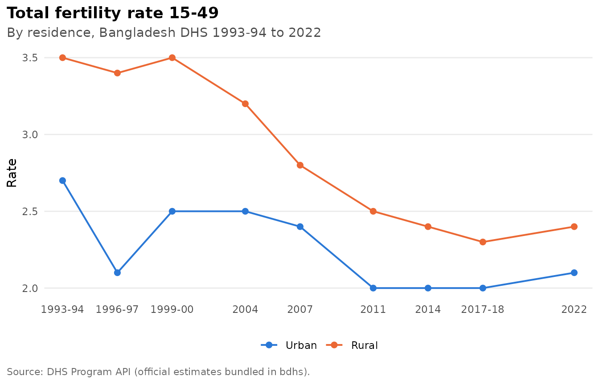
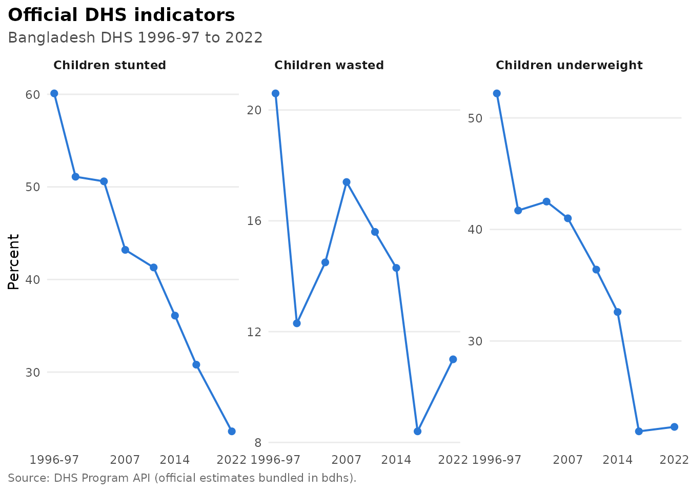
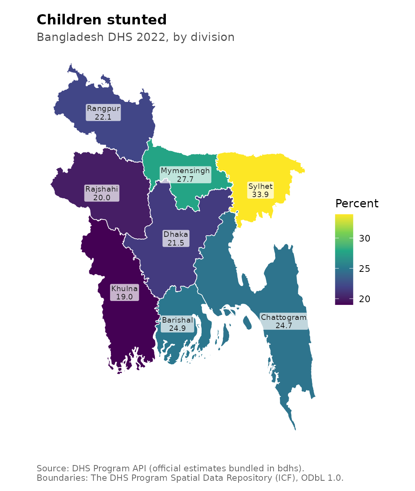

# Official estimates: trends and maps

Everything in this article works straight after installing bdhs. You
don’t need a DHS account or any downloads, because the package ships
every official estimate the DHS Program publishes for Bangladesh. These
are the numbers in the BDHS final reports and in STATcompiler.

``` r

library(bdhs)
```

## What is bundled

`bdhs_indicators` holds about 310,000 official values. That covers every
indicator, every survey round from 1993-94 to 2022, and every published
breakdown: national, division and background characteristics such as
residence, education and wealth. `bdhs_indicator_catalog` describes each
indicator (definition, denominator, topic and the rounds it covers).

``` r

nrow(bdhs_indicators)
#> [1] 310528
dplyr::count(bdhs_indicator_catalog, topic, sort = TRUE)
#> # A tibble: 21 × 2
#>    topic                          n
#>    <chr>                      <int>
#>  1 Family Planning              366
#>  2 Child Health                 271
#>  3 Child Nutrition              216
#>  4 Household Characteristics    195
#>  5 Reproductive Health          189
#>  6 Water and Sanitation         160
#>  7 Fertility                    151
#>  8 Education                    141
#>  9 Infant and Child Mortality   137
#> 10 Women's Empowerment          115
#> # ℹ 11 more rows
```

## Finding an indicator

[`bdhs_search()`](https://armanhossen-am.github.io/bdhs/reference/bdhs_search.md)
looks through indicator labels and definitions, survey variables and
harmonized variables at once. Restrict it to indicators with
`where = "indicators"`:

``` r

bdhs_search("stunt", where = "indicators")
#> # bdhs search for "stunt": 2 matches
#> 
#> ── Official DHS indicators (2) ─────────────────────────────────────────────────
#> CN_NUTS_C_HA3  Children severely stunted  1996-97, 1999-00, 2004, 2007, 2011, 2014, 2017-18, 2022
#> CN_NUTS_C_HA2  Children stunted           1996-97, 1999-00, 2004, 2007, 2011, 2014, 2017-18, 2022
```

## Pulling official values

[`bdhs_official()`](https://armanhossen-am.github.io/bdhs/reference/bdhs_official.md)
returns tidy rows for one or more indicators. By default it gives the
national headline value for every round:

``` r

bdhs_official("CN_NUTS_C_HA2")[, c("year_label", "indicator", "value", "ci_low", "ci_high")]
#> # A tibble: 8 × 5
#>   year_label indicator        value ci_low ci_high
#>   <chr>      <chr>            <dbl>  <dbl>   <dbl>
#> 1 1996-97    Children stunted  60.1     NA      NA
#> 2 1999-2000  Children stunted  51.1     NA      NA
#> 3 2004       Children stunted  50.6     NA      NA
#> 4 2007       Children stunted  43.2     NA      NA
#> 5 2011       Children stunted  41.3     NA      NA
#> 6 2014       Children stunted  36.1     NA      NA
#> 7 2017-18    Children stunted  30.8     NA      NA
#> 8 2022       Children stunted  23.6     NA      NA
```

Ask for a breakdown to get subgroup values, for example by division in
2022:

``` r

stunting_div <- bdhs_official("CN_NUTS_C_HA2", survey = 2022, breakdown = "subnational")
stunting_div[, c("characteristic_label", "value", "denom_unweighted")]
#> # A tibble: 11 × 3
#>    characteristic_label value denom_unweighted
#>    <chr>                <dbl>            <dbl>
#>  1 Barishal              24.9              496
#>  2 Chattogram/Sylhet     27               1278
#>  3 Chattogram            24.7              732
#>  4 Sylhet                33.9              546
#>  5 Dhaka before 2015     23.2             1132
#>  6 Dhaka                 21.5              607
#>  7 Mymensingh            27.7              525
#>  8 Khulna                19                450
#>  9 Rajshahi/Rangpur      21.1              904
#> 10 Rangpur               22.1              491
#> 11 Rajshahi              20                413
```

Besides the eight current divisions, the DHS Program also publishes the
older groupings, such as “Chattogram/Sylhet”, “Dhaka before 2015” (Dhaka
plus Mymensingh) and “Rajshahi/Rangpur”. These match the division layout
of earlier rounds, so they are the values to use for long-run regional
trends.

The `survey` argument accepts years, year ranges, DHS ids and file
codes, so `2017`, `"2017-18"`, `"BD2017DHS"` and `"7R"` all mean the
2017-18 survey.

## Trends

[`bdhs_plot_trend()`](https://armanhossen-am.github.io/bdhs/reference/bdhs_plot_trend.md)
draws an indicator across all rounds. Give it a characteristic category
to split the trend:

``` r

bdhs_plot_trend("FE_FRTR_W_TFR", by = "Residence")
```



Several indicators can share one chart:

``` r

bdhs_plot_trend(c("CN_NUTS_C_HA2", "CN_NUTS_C_WH2", "CN_NUTS_C_WA2"))
```



## Maps

[`bdhs_boundaries()`](https://armanhossen-am.github.io/bdhs/reference/bdhs_boundaries.md)
returns the division boundaries used by a given survey, as an `sf`
object. They come from the DHS Program Spatial Data Repository under the
Open Database License. The number of divisions changed over time: 5 in
1993-94, 6 from 1996-97, 7 from 2011 (Rangpur) and 8 from 2017-18
(Mymensingh).

``` r

b <- bdhs_boundaries(2022)
b[, c("region_code", "region_name")]
#> Simple feature collection with 8 features and 2 fields
#> Geometry type: MULTIPOLYGON
#> Dimension:     XY
#> Bounding box:  xmin: 88.03243 ymin: 20.59039 xmax: 92.68078 ymax: 26.63625
#> Geodetic CRS:  WGS 84
#>   region_code region_name                       geometry
#> 1           1    Barishal MULTIPOLYGON (((90.33083 21...
#> 2           2  Chattogram MULTIPOLYGON (((91.85583 21...
#> 3           3       Dhaka MULTIPOLYGON (((89.35535 23...
#> 4           4      Khulna MULTIPOLYGON (((89.2995 21....
#> 5           5  Mymensingh MULTIPOLYGON (((89.64786 25...
#> 6           6    Rajshahi MULTIPOLYGON (((88.7203 24....
#> 7           7     Rangpur MULTIPOLYGON (((88.83978 25...
#> 8           8      Sylhet MULTIPOLYGON (((90.96542 25...
```

[`bdhs_map()`](https://armanhossen-am.github.io/bdhs/reference/bdhs_map.md)
draws an official indicator by division:

``` r

bdhs_map("CN_NUTS_C_HA2", survey = 2022)
```



It also maps your own estimates. Any data frame with division codes
(`v024`, `hv024`, `region_code`) or division names works, including the
output of `bdhs_estimate(..., by = "v024")`.

## Notes on comparability

- Division layouts differ between rounds, so division-level trends are
  only comparable after back-mapping to a common layout. `bdhs_regions`
  gives the crosswalk, and
  [`bdhs_harmonize()`](https://armanhossen-am.github.io/bdhs/reference/bdhs_harmonize.md)
  creates `division_trend6` and `division_trend5` for microdata.
- Official values are rounded the way the DHS Program publishes them.
  Values you compute from microdata with
  [`bdhs_estimate()`](https://armanhossen-am.github.io/bdhs/reference/bdhs_estimate.md)
  keep full precision.
- Please cite the DHS Program API when you use these values
  (`citation("bdhs")`).
