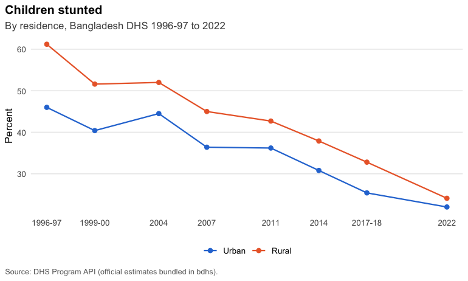
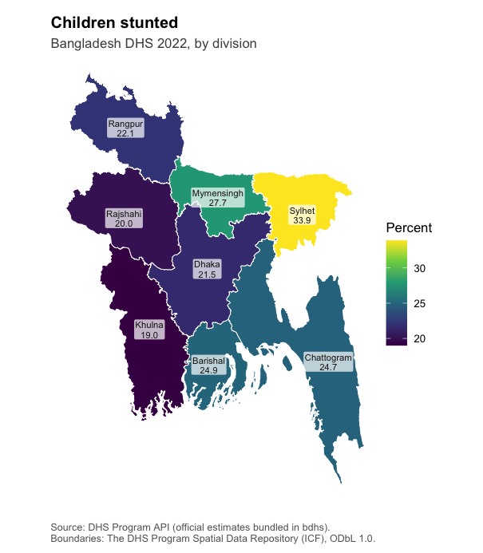

# bdhs

**bdhs** is an R toolkit for every round of the **Bangladesh Demographic
and Health Survey**: 1993-94, 1996-97, 1999-2000, 2004, 2007, 2011,
2014, 2017-18 and 2022. It also covers the Bangladesh Service Provision
Assessments and the 2001 maternal mortality survey.

It does two jobs:

1.  **Ships the official numbers.** Every estimate the DHS Program
    publishes for Bangladesh (about 310,000 values: national, by
    division, by residence, wealth, education and more), with
    definitions, survey and dataset catalogues, cross-round codebooks,
    division crosswalks and maps. These work straight after
    installation, with no DHS account.
2.  **Makes your own microdata painless.** Once you have downloaded BDHS
    files from the DHS Program, bdhs registers them, reads any round in
    one line, harmonizes variables across rounds, builds the correct
    complex survey design, pools rounds, and computes indicators that
    are validated against the official DHS estimates.

> **Why isn’t the microdata included, like in `brfss`?** BRFSS is US
> public domain data. DHS microdata are licensed to registered users,
> and the DHS terms of use say they “will not be re-distributed, either
> directly or within any tool”. bdhs respects that: it never bundles or
> uploads microdata. Registration is free and quick:
> <https://dhsprogram.com/data/new-user-registration.cfm>.

## Installation

``` r

# install.packages("pak")
pak::pak("armanhossen-am/bdhs")
```

## Official estimates in one line

``` r

library(bdhs)

bdhs_official("FE_FRTR_W_TFR")[, c("year_label", "indicator", "value")]
#> # A tibble: 9 × 3
#>   year_label indicator                  value
#>   <chr>      <chr>                      <dbl>
#> 1 1993-94    Total fertility rate 15-49   3.4
#> 2 1996-97    Total fertility rate 15-49   3.3
#> 3 1999-2000  Total fertility rate 15-49   3.3
#> 4 2004       Total fertility rate 15-49   3  
#> 5 2007       Total fertility rate 15-49   2.7
#> 6 2011       Total fertility rate 15-49   2.3
#> 7 2014       Total fertility rate 15-49   2.3
#> 8 2017-18    Total fertility rate 15-49   2.3
#> 9 2022       Total fertility rate 15-49   2.3
```

``` r

bdhs_plot_trend("CN_NUTS_C_HA2", by = "Residence")
```



``` r

bdhs_map("CN_NUTS_C_HA2", survey = 2022)
```



Not sure what an indicator or variable is called? Search everything at
once:

``` r

bdhs_search("caesarean|cesarean")
#> # bdhs search for "caesarean|cesarean": 151 matches
#> 
#> ── Variables (145) ─────────────────────────────────────────────────────────────
#> m17_1-6 [IR]     delivery by caesarean section                     2017-18, 2022
#> m17a_1-6 [IR]    na - timing on decision for caesarean section     2017-18, 2022
#> v401 [IR]        last birth a caesarean section                    2017-18, 2022
#> s433ka_1-6 [IR]  who was called for caesarean: qualified doctor    2017-18
#> s433kb_1-6 [IR]  who was called for caesarean: nurse/midwife/p...  2017-18
#> s433kc_1-6 [IR]  who was called for caesarean: family welfare ...  2017-18
#> s433kd_1-6 [IR]  who was called for caesarean: community skill...  2017-18
#> s433ke_1-6 [IR]  who was called for caesarean: sub-assistant c...  2017-18
#> s433kf_1-6 [IR]  who was called for caesarean: community healt...  2017-18
#> s433kg_1-6 [IR]  who was called for caesarean: health assistant    2017-18
#> ... and 50 more
#> 
#> ── Official DHS indicators (4) ─────────────────────────────────────────────────
#> RH_DELA_C_CSC  Delivery by cesarean section         1999-00, 2004, 2007, 2011, 2014, 2017-18, 2022
#> RH_DELA_C_CSP  Delivery by caesarean section pl...  2017-18
#> RH_DELA_C_CSA  Delivery by caesarean section de...  2017-18
#> RH_DELA_C_CSM  Delivery by caesarean section - ...  2017-18
#> 
#> ── Computable with bdhs_estimate() (1) ─────────────────────────────────────────
#> rh_del_csection  Delivery by caesarean section ...  1996-97, 1999-00, 2004, 2007, 2011, 2014, 2017-18, 2022
#> 
#> ── Harmonized variables (1) ────────────────────────────────────────────────────
#> csection  Delivery by caesarean section (m17)  1999-00, 2004, 2007, 2011, 2014, 2017-18, 2022
#> 
#> # Use `print(x, n = Inf)` to see every match.
```

## Your microdata in one line

``` r

# Once: register the files you downloaded (folders, zips, renamed files are fine)
bdhs_import("~/Downloads/BDHS")
bdhs_inventory()                       # what you have vs. what exists

ir <- bdhs_read(2022, "IR")            # women, 2022
kr <- bdhs_read("2017-18", "KR")       # children, 2017-18

bdhs_estimate(kr, c("rh_anc_4plus", "rh_del_facility", "rh_del_csection"),
              by = "v025")             # correct design, SEs, CIs
bdhs_validate(kr)                      # compare with official DHS values

# Big files: read only what some indicators need
ir <- bdhs_read(2022, "IR", indicators = c("fp_cpr_modern", "fp_unmet_total"))

bdhs_mortality(bdhs_read(2022, "BR"))  # NMR, IMR, U5MR with jackknife SEs
```

The same code runs on synthetic data from
[`bdhs_simulate()`](https://armanhossen-am.github.io/bdhs/reference/bdhs_simulate.md),
which has the structure of the real files with random values. That is
how the examples, tests and vignettes run without real files:

``` r

kr <- bdhs_simulate(2022, "KR")
bdhs_estimate(kr, c("rh_anc_4plus", "rh_del_facility", "rh_del_csection"), by = "v025")
#> # BDHS estimates: 3 indicators | BD2022DHS | 95% CI
#> # A tibble: 6 × 11
#>   survey_id indicator     label v025  estimate    se ci_low ci_high n_unweighted
#>   <chr>     <chr>         <chr> <fct>    <dbl> <dbl>  <dbl>   <dbl>        <int>
#> 1 BD2022DHS rh_anc_4plus  Four… urban     43.5  5.78   32.2    55.6           70
#> 2 BD2022DHS rh_anc_4plus  Four… rural     23.8  3.10   18.0    30.8           75
#> 3 BD2022DHS rh_del_facil… Deli… urban     59.4  7.93   42.6    74.2           78
#> 4 BD2022DHS rh_del_facil… Deli… rural     49.7  2.96   43.7    55.8           84
#> 5 BD2022DHS rh_del_csect… Deli… urban     29.2  6.66   17.5    44.5           78
#> 6 BD2022DHS rh_del_csect… Deli… rural     31.4  4.08   23.6    40.4           84
#> # ℹ 2 more variables: n_weighted <dbl>, api_id <chr>
```

## What’s inside

| Bundled data | What it is |
|----|----|
| `bdhs_indicators` | Every official DHS estimate for Bangladesh, all rounds and breakdowns |
| `bdhs_indicator_catalog` | Definitions, denominators and coverage of each indicator |
| `bdhs_surveys`, `bdhs_datasets` | Survey facts and the full list of 441 DHS data files |
| `bdhs_codebook`, `bdhs_value_labels` | Variable names, labels and value labels across rounds (metadata only) |
| `bdhs_regions` | Division codes per round with a cross-round crosswalk |
| `bdhs_pool_population` | Female population 15-49 for pooled (de-normalized) weights |
| [`bdhs_boundaries()`](https://armanhossen-am.github.io/bdhs/reference/bdhs_boundaries.md) | Division boundaries for each survey (DHS Spatial Data Repository) |

| Task | Functions |
|----|----|
| Official estimates | [`bdhs_official()`](https://armanhossen-am.github.io/bdhs/reference/bdhs_official.md), [`bdhs_plot_trend()`](https://armanhossen-am.github.io/bdhs/reference/bdhs_plot_trend.md), [`bdhs_map()`](https://armanhossen-am.github.io/bdhs/reference/bdhs_map.md) |
| Discover | [`bdhs_search()`](https://armanhossen-am.github.io/bdhs/reference/bdhs_search.md), [`bdhs_variable()`](https://armanhossen-am.github.io/bdhs/reference/bdhs_variable.md), [`bdhs_describe()`](https://armanhossen-am.github.io/bdhs/reference/bdhs_describe.md) |
| Your files | [`bdhs_import()`](https://armanhossen-am.github.io/bdhs/reference/bdhs_import.md), [`bdhs_read()`](https://armanhossen-am.github.io/bdhs/reference/bdhs_read.md), [`bdhs_inventory()`](https://armanhossen-am.github.io/bdhs/reference/bdhs_inventory.md), [`bdhs_download()`](https://armanhossen-am.github.io/bdhs/reference/bdhs_download.md) |
| Cross-round work | [`bdhs_harmonize()`](https://armanhossen-am.github.io/bdhs/reference/bdhs_harmonize.md), [`bdhs_pool()`](https://armanhossen-am.github.io/bdhs/reference/bdhs_pool.md), [`bdhs_merge()`](https://armanhossen-am.github.io/bdhs/reference/bdhs_merge.md), [`bdhs_na()`](https://armanhossen-am.github.io/bdhs/reference/bdhs_na.md) |
| Estimation | [`bdhs_design()`](https://armanhossen-am.github.io/bdhs/reference/bdhs_design.md), [`bdhs_estimate()`](https://armanhossen-am.github.io/bdhs/reference/bdhs_estimate.md), [`bdhs_fertility()`](https://armanhossen-am.github.io/bdhs/reference/bdhs_fertility.md), [`bdhs_mortality()`](https://armanhossen-am.github.io/bdhs/reference/bdhs_mortality.md), [`bdhs_validate()`](https://armanhossen-am.github.io/bdhs/reference/bdhs_validate.md) |
| Change and inequality | [`bdhs_compare()`](https://armanhossen-am.github.io/bdhs/reference/bdhs_compare.md), [`bdhs_inequality()`](https://armanhossen-am.github.io/bdhs/reference/bdhs_inequality.md), [`bdhs_decompose()`](https://armanhossen-am.github.io/bdhs/reference/bdhs_decompose.md), [`bdhs_sdg()`](https://armanhossen-am.github.io/bdhs/reference/bdhs_sdg.md) |
| Data quality | [`bdhs_quality()`](https://armanhossen-am.github.io/bdhs/reference/bdhs_quality.md) |
| Teaching and testing | [`bdhs_simulate()`](https://armanhossen-am.github.io/bdhs/reference/bdhs_simulate.md), [`bdhs_synthesize()`](https://armanhossen-am.github.io/bdhs/reference/bdhs_synthesize.md) (synthetic data calibrated to official estimates) |

## Things bdhs handles for you

- **Ever-married samples.** Every BDHS women’s sample is ever-married
  women, so “all women” indicators need the DHS all-woman factors
  (`awfactt` and friends). bdhs applies them where the DHS does.
- **Changing divisions.** Bangladesh went from 5 divisions (1993-94) to
  8 (2017-18 on), and the codes were renumbered when Mymensingh was
  created. bdhs maps every round onto consistent layouts.
- **Correct designs.** Clusters, sampling-error strata and weights per
  round, lonely PSUs, and pooled multi-round designs.
- **DHS quirks.** Special missing codes, flagged z-scores, 2-digit years
  in the early rounds, renamed and re-saved files, and recodes that only
  exist for some rounds.

## Getting help and contributing

Questions, bug reports and feature requests are welcome as [GitHub
issues](https://github.com/armanhossen-am/bdhs/issues), or by email to
<hossena@miamioh.edu>. Please never attach DHS microdata; use
[`bdhs_simulate()`](https://armanhossen-am.github.io/bdhs/reference/bdhs_simulate.md)
to make a reproducible example. See the [contributing
guide](https://github.com/armanhossen-am/bdhs/blob/main/.github/CONTRIBUTING.md)
for how to report problems and submit changes.

## Citation and conditions of use

Please cite bdhs and the data sources (`citation("bdhs")`). When you
publish results from BDHS microdata, cite the survey’s final report. The
DHS Program’s conditions for Bangladesh also ask you to send a copy of
the publication to the NIPORT library.

bdhs is not affiliated with or endorsed by the DHS Program, ICF or
NIPORT.
